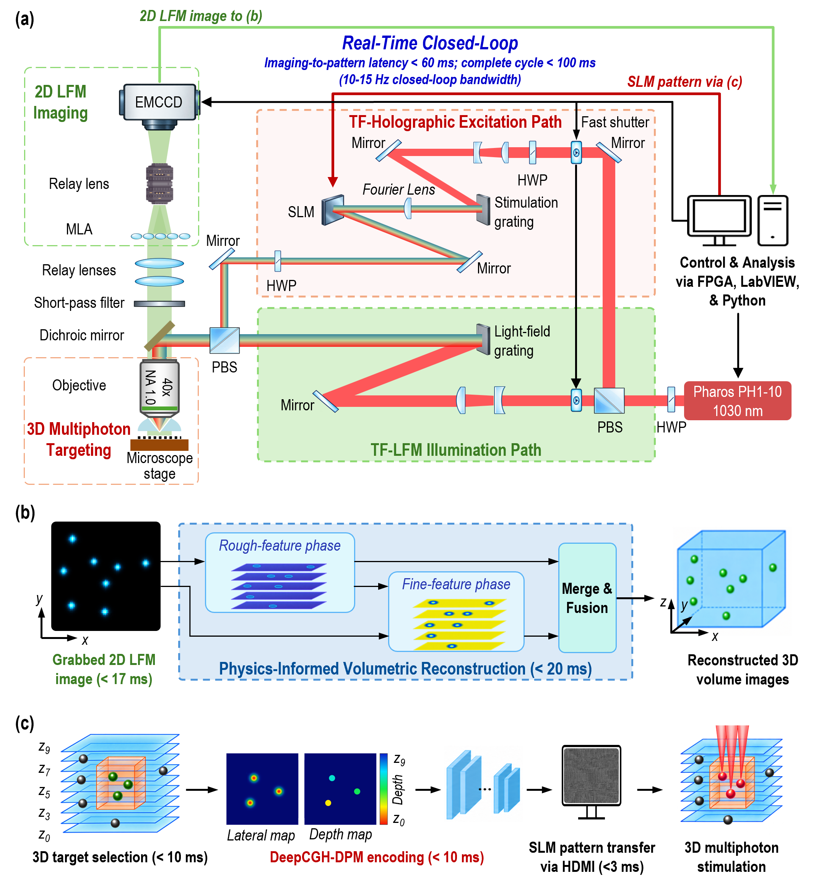
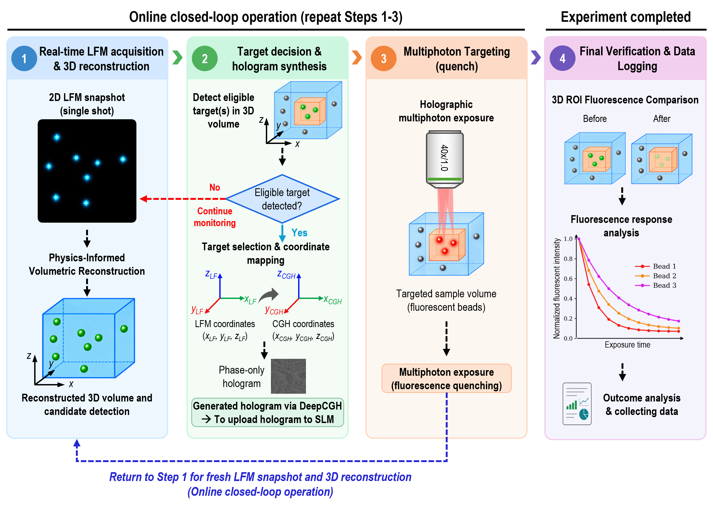
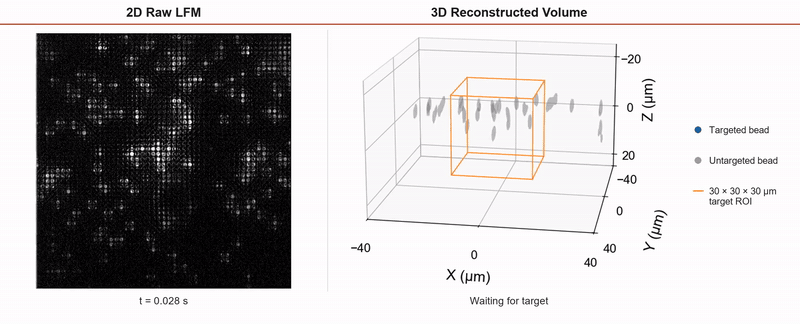

# Closed-loop 3D multiphoton targeting

This repository contains the two trained networks used in the work, small example datasets, example SLM patterns, and the final manuscript figures.

## System overview

The platform combines light-field microscopy, physics-informed volumetric reconstruction, three-dimensional target selection, DeepCGH hologram generation, multiphoton exposure, and fluorescence-feedback verification in a closed loop.



*Figure 1. Optical system and image-to-pattern pipeline.*



*Figure 2. Target selection, hologram synthesis, multiphoton targeting, and post-stimulation feedback.*

## Closed-loop demonstration

[](video/Closed_Loop_3D_Multiphoton_Targeting.mp4)

*Animated preview of dynamic 3D targeting. Click the preview to open the full 11-cycle LF/3D video (2D raw LFM with the 30 × 30 µm target ROI, and the reconstructed 3D volume).*

## Contents

```text
models/
  lf_network/          LF image to 3D reconstruction
  deepcgh/             3D target coordinates to SLM pattern
examples/
  raw_lf/              Representative raw LF camera images
  registered_lf/       Registered 517 × 517 LF inputs for the LF network
  patterns/            Example 1024 × 1024 SLM patterns
usage/
  run_lf_network.py
  run_deepcgh.py
benchmark/
  BENCHMARK.md         Compact timing summary
figures/
  Picture1.png ... Picture5.png   Final paper figures 1-5
video/
  Closed_Loop_3D_Multiphoton_Targeting.mp4
```

Figure- and video-rendering scripts are intentionally not included. The repository demonstrates the core pipeline:

```text
registered LF image -> LF network -> 3D volume
3D target coordinates -> DeepCGH network -> SLM pattern
```

## Installation

Python 3.11 and a CUDA-enabled PyTorch installation are recommended.

```powershell
python -m venv .venv
.\.venv\Scripts\Activate.ps1
python -m pip install --upgrade pip
python -m pip install torch numpy scipy tifffile
```

Install the PyTorch build appropriate for the local CUDA version if GPU support is required.

## LF reconstruction network

The LF network accepts a registered `517 × 517` LF image and returns a `91 × 517 × 517` volume in `Z,Y,X` order. The included raw camera examples are provided for inspection; network inference requires the registered examples in `examples/registered_lf`.

```powershell
python usage/run_lf_network.py
```

The example writes `outputs/lf_volume_zyx.npy`. The network is loaded once and should remain resident for repeated inference.

## DeepCGH network

DeepCGH accepts target rows `[x_um, y_um, z_um, intensity]` and returns a `1024 × 1024` `uint8` SLM pattern.

```powershell
python usage/run_deepcgh.py
```

The example warms up the network, generates a three-target pattern, and writes `outputs/deepcgh_pattern.tif`.

## Benchmark

A compact image-to-pattern timing summary is available in [benchmark/BENCHMARK.md](benchmark/BENCHMARK.md). It reports 10 measured trials after discarding the first measured cold-start trial.

## Supplementary video

The paired raw-LF and reconstructed-3D demonstration is provided as [Closed_Loop_3D_Multiphoton_Targeting.mp4](video/Closed_Loop_3D_Multiphoton_Targeting.mp4). The video shows the complete dynamic closed-loop targeting sequence, including target motion, targeting events, and feedback states.

## Example data

- `examples/raw_lf`: static and dynamic before/after camera frames, with NPY, TIFF, and PNG preview files.
- `examples/registered_lf`: three network-ready LF examples, with NPZ, TIFF, and PNG preview files.
- `examples/patterns`: one static and two dynamic experimentally generated SLM patterns, with TIFF and PNG files.

These examples demonstrate file formats and inference. They are not a complete archive of the experimental sessions.

## Models

- LF reconstruction: selected H1 → H2 → learned-fusion checkpoint, with metadata in `models/lf_network/bundle.json`.
- DeepCGH: validated 256 × 256 model using `models/deepcgh/DeepCGH_Models256/best.pt`, converted to a 1024 × 1024 SLM gray-level pattern.

## License

See [LICENSE](LICENSE).
